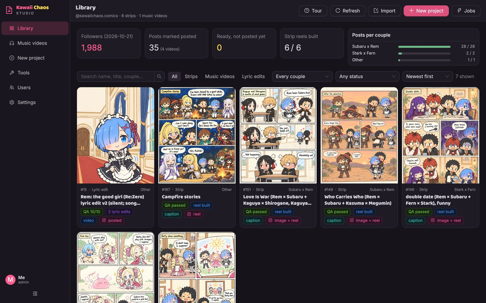
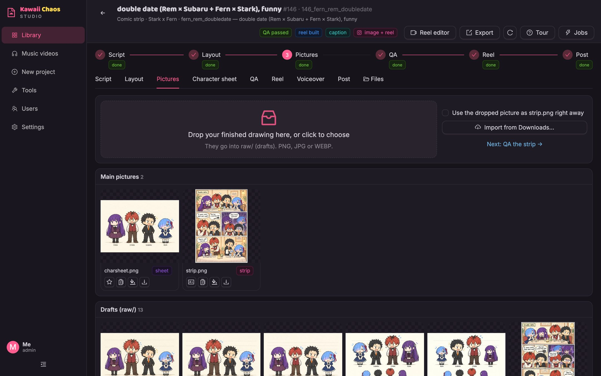
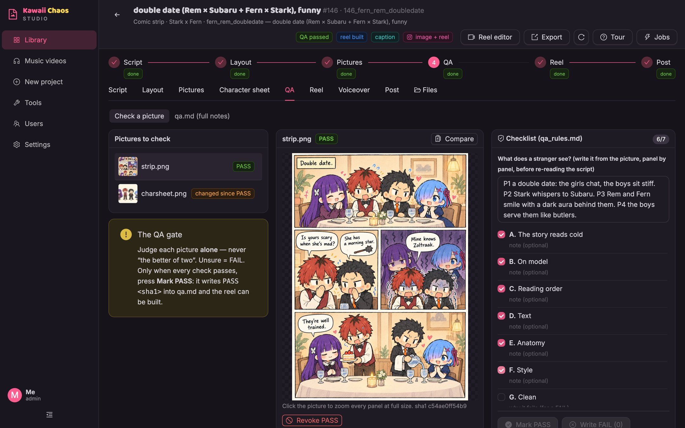
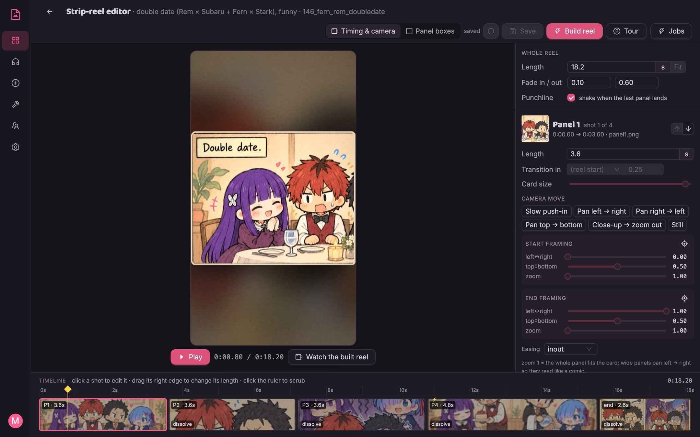
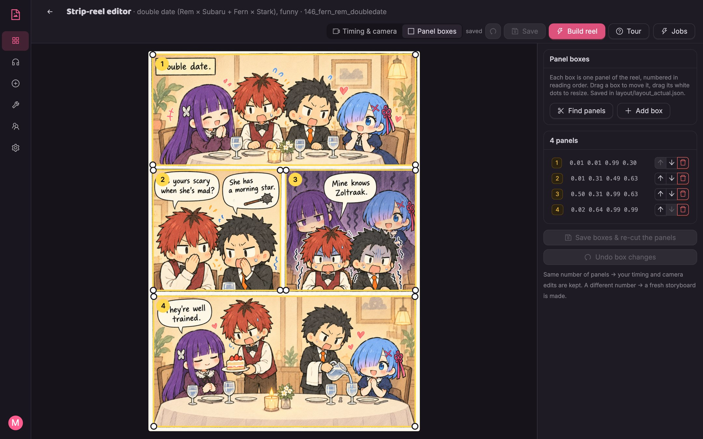
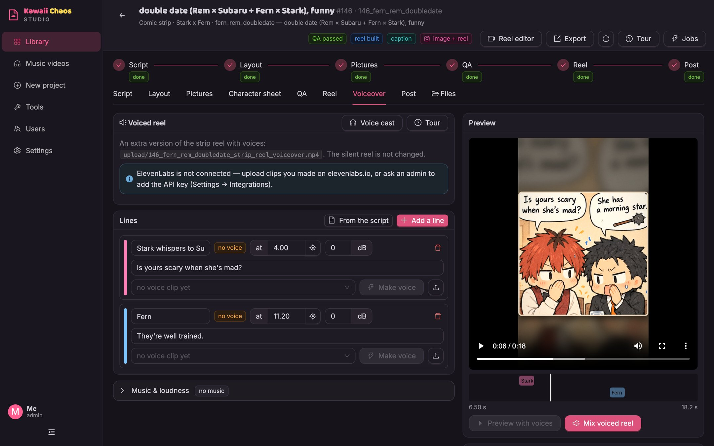
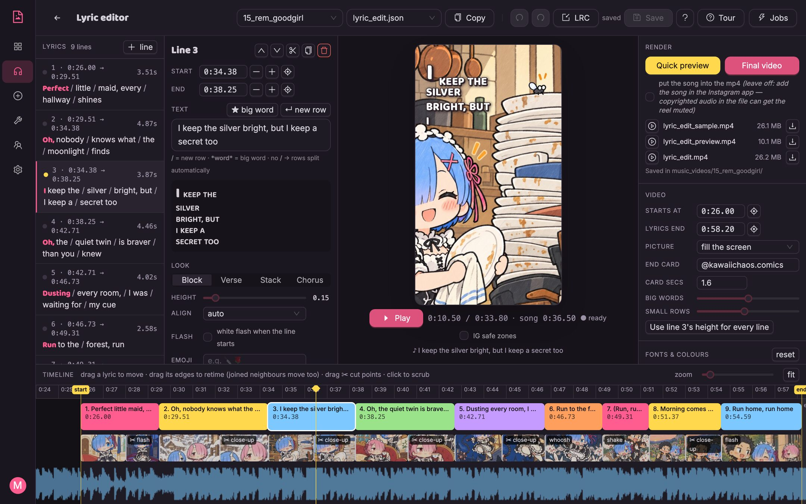
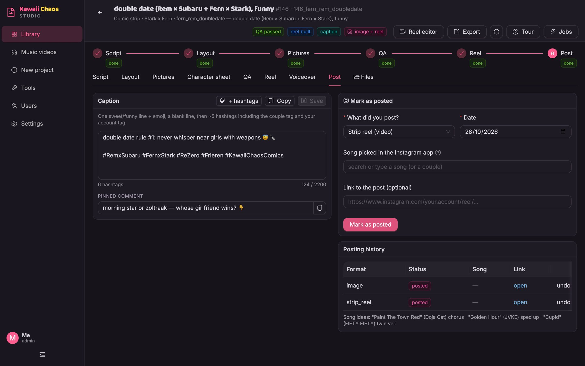
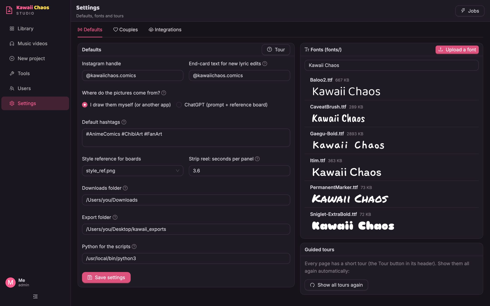
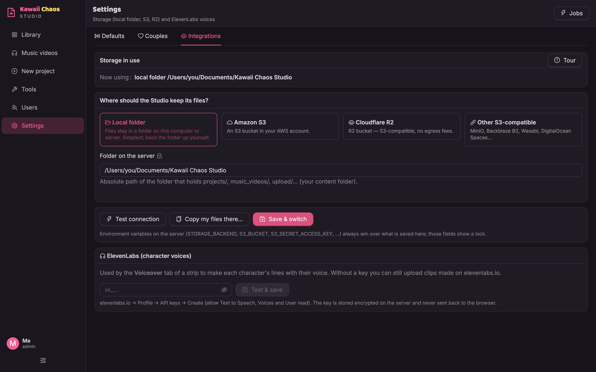

# Kawaii Chaos Studio

A friendly app for making **comic strips and comic reels** for Instagram and TikTok. Write the script, draw (or
import) the strip, check it against your own checklist, turn it into a panel-by-panel reel, add character voices, write
the caption and keep track of what you posted.

It runs on your own computer (there is a Mac app, or run it from source), and can also be put on a server for a small
team. It was made for chibi fan-comic accounts, but nothing in it is tied to one series, couple or account.



## Contents

- [What it does](#what-it-does)
- [Install the Mac app](#install-the-mac-app-easiest)
- [Run from source](#run-from-source-macos-linux-windows-with-wsl)
- [How a strip goes from idea to reel](#how-a-strip-goes-from-idea-to-reel)
- [A tour of the app](#a-tour-of-the-app)
- [Your content folder](#your-content-folder)
- [Settings worth knowing](#settings-worth-knowing)
- [On a server](#on-a-server)
- [FAQ and troubleshooting](#faq-and-troubleshooting)
- [The manual](#the-manual)
- [Development](#development)
- [Contributing](#contributing) · [Licence](#licence) · [Fan art](#fan-art)

## What it does

| | |
|---|---|
| **Strips** | Script with panels → optional random panel layout to draw on → your drawing (or a ChatGPT picture) → QA checklist → strip reel → caption → posted. |
| **Strip reels** | A 9:16 video that shows the strip panel by panel and only reveals the whole strip at the end. Automatic, or fix the panel boxes, timing and camera moves in the **Reel editor**. Silent, so you add a song in the Instagram/TikTok app. |
| **Voiced reels** | Character voices on the reel: a **voice cast** (the same ElevenLabs voice for a character every time), lines placed on the timeline, music ducked under the voices, one mix. Use the ElevenLabs API or upload clips you recorded or made elsewhere. |
| **Lyric edits / music videos** | Pictures + lyric lines timed to a song (tap to time), fonts, colours and camera moves, a smooth in-browser preview and a final render. |
| **QA gate** | Your own checklist (`qa_rules.md`). A reel is only built for a picture that passed it. |
| **Posting** | Captions, pinned comments, song ideas, a posting log, an export folder (e.g. AirDrop). |
| **Your own way** | Your drawings, fonts, songs and checklist. ChatGPT steps are optional (Settings → *Where do the pictures come from?*). |
| **Team & server** | Accounts with roles (viewer / editor / admin), optional two-factor sign-in, storage on the local disk, Amazon S3, Cloudflare R2 or any S3-compatible service, Docker. |

Every page has a **Tour** button (top right) that walks you through it. The tour also starts by itself the first time
you open a page.

## Install the Mac app (easiest)

Download **`Kawaii-Chaos-Studio-<version>-mac-arm64.dmg`** from [Releases](../../releases), open it and drag the app
into Applications. It needs macOS 12+ on Apple Silicon (M1 or newer). Nothing else to install — ffmpeg is included.

- **First open:** the app is not notarized by Apple yet, so macOS warns. Right-click the app → **Open** → **Open**
  (macOS 15+: try to open it once, then System Settings → Privacy & Security → **Open Anyway**).
- **No account, no password:** the app signs you in by itself and only listens on your own Mac.
- **Your comics** are plain files in `Documents/Kawaii Chaos Studio/`; the app's local database (SQLite), settings and
  logs are in `~/Library/Application Support/Kawaii Chaos Studio/`.
- **Move projects** between Macs or friends: a project's **Export** button makes a `.zip`; **Library → Import** adds it.

## Run from source (macOS, Linux, Windows with WSL)

You need **Python 3.11+**, **Node.js 24 LTS** (24.22.1 or newer; see `.nvmrc`) and **ffmpeg** (macOS:
`brew install python node ffmpeg`; Ubuntu: `sudo apt install python3-venv nodejs npm ffmpeg`).

```bash
git clone <this repo> kawaii-chaos-studio
cd kawaii-chaos-studio
studio/run.sh
```

The first run installs what it needs, builds the web app and opens **http://localhost:8770**. Create your admin
account on the first screen (there are no default passwords). Your comics are kept in **`data/`** (git-ignored); it is
created from `starter/` the first time. Use another folder with `STUDIO_DATA_DIR=/path/to/folder studio/run.sh`.
Stop it with Ctrl+C in that terminal.

## How a strip goes from idea to reel

A strip page has a **steps** bar (Script → Layout → Prompt → Pictures → QA → Reel → Post) that shows what is done; click
a step to go there.

1. **New project** → *Strip*: give it a name, couple, title, mood and number of panels. The Studio picks the next
   number (`projects/NNN_name/`), writes a script template and, for strips, a random panel layout. Existing names are
   refused — nothing is overwritten.
2. **Script**: write the panels in `synopsis.md`, one short line each, with a live preview. The `**Caption:**`,
   `**Pinned comment:**` and `**Song ideas**` lines are used later by the Post tab.
3. **Layout** (optional): a random panel wireframe to draw on.
4. **Prompt** (only when pictures come from ChatGPT): the prompt and a reference board to attach.
5. **Pictures**: drop your finished drawing (or import from Downloads). Pick the one that becomes `strip.png`.
6. **QA**: write what a stranger sees, tick every check from your `qa_rules.md`, then **Mark PASS**. This writes
   `PASS <sha1> strip.png` into `qa.md`; if the picture changes later, the PASS no longer counts.
7. **Reel**: **Build reel (automatic)**, or open the **Reel editor** to fix the panel boxes, timing and camera.
   The finished files land in `upload/` (`NNN_name_strip_reel.mp4` and `NNN_name_strip.png`).
8. **Voiceover** (optional): a voiced copy of the reel next to the silent one.
9. **Post**: copy the caption and pinned comment, post in the Instagram/TikTok app (pick the song there), then
   **Mark as posted** so it shows up in the posting log and the Library stats.

## A tour of the app

### Library

All strips, music videos and lyric edits as cards with their picture and status (**QA passed / needs QA / QA
outdated**, **reel built**, **caption**, **posted**). Search, filter by type, couple and status (*Needs QA*, *Needs a
reel*, *Ready to post*, …) and sort. The top row shows followers, posts and posts per couple from `posting_log.json`.
**Import** adds a project exported from another Studio. See the screenshot at the top.

### A strip: pictures and character sheet



Every picture of the project: the main ones, drafts in `raw/`, rejected ones and the layout. Drop your own pictures or
**Import from Downloads**; ★ makes a picture the `strip.png`, the card icon makes it the `charsheet.png`. **Compare**
puts a picture next to your style reference (both sides zoom together) and **Style check** measures it. The
**Character sheet** tab keeps `charsheet.png` and can even out the characters' heights. The **Files** tab lets you browse
and download every file of the project.

### The QA checklist



Pick a picture, write what a stranger sees, tick the checks from `qa_rules.md` (hover a check for the full rule).
**Mark PASS** only works when every check is ticked. **Write FAIL** records the failing checks, **Revoke PASS** takes a
pass back, and the *qa.md* view edits the whole file. The checklist is yours: change `qa_rules.md` to fit your comics.

### Reel editor



**Timing & camera**: the reel's shots on a timeline (drag a block's right edge to change its length) and a preview made
by the real renderer. Per shot: length, order, transition, card size, camera presets (push-in, pans, close-up → zoom
out, still) or exact start/end framing, and easing. For the whole reel: total length (*Fit* stretches every panel),
fades and a punchline shake. **Build reel** renders it and writes the files to `upload/`. It needs the QA PASS.



**Panel boxes**: the panels drawn over `strip.png`. Drag a box to move it, drag its white dots to resize, add, delete
and reorder; **Find panels** detects them automatically. **Save boxes & re-cut** cuts new panel pictures and keeps your
timing when the number of panels stays the same.

### Voiceover



An optional *voiced* version of the reel (`upload/NNN_name_strip_reel_voiceover.mp4`; the silent reel stays).
**Voice cast** sets which ElevenLabs voice each character uses (`voices.json`, shared by every project). **From the
script** fills the lines from the dialogue in the synopsis, placed on their panels. **Make voice** uses ElevenLabs
text-to-speech (a new take each time, older takes kept, shows the credit cost), or upload a clip you made elsewhere.
**Preview with voices** plays it in the page; **Mix voiced reel** puts the clips at their times, ducks the music under
the voices and evens out the loudness. Without an ElevenLabs key you can still upload clips.

### Lyric editor



For music videos and lyric edits (`music_videos/NN_name/`). Every line has a time, a look (Block / Verse / Stack /
Chorus), pictures and cuts (close-ups, flash, whoosh, shake). The preview shows the exact frame of the final video.
Load the song, press **Space** to play and **T** to time each line as it starts. Drag lyrics and cut points on the
timeline, pick a font and colours per role, then make a **Quick preview** (540p) or the **Final video** (1080p).
**LRC** imports `[mm:ss.xx]` timings. Songs are never baked into the video unless you tick the box.

### Post



Caption and pinned comment (saved to `captions.json` **and** the synopsis), *+ hashtags* and copy buttons. **Mark as
posted** records the format, date, song (from the `songs.md` shortlists or typed) and post link in
`posting_log.json`, with the history and *undo*.

### Settings





See [Settings worth knowing](#settings-worth-knowing) below. Other pages not shown here: **Music videos** (the list of
music-video folders and their lyric edits), **New project**, **Tools** (the repo scripts as buttons, e.g. *Make the PDF
book* and *Build every missing strip reel*, each a background job you can follow under **Jobs**) and **Users** (admins
only).

## Your content folder

```
data/
  projects/NNN_name/       one strip: synopsis.md, strip.png, qa.md, raw/ drafts, layout/, strip_reel/, voiceover/
  music_videos/NN_name/    a music video or lyric edit: frames, lyric_edit*.json, audio/
  upload/                  finished files to post (strip images, reels, voiced reels)
  references/              style references (style_ref.png) and character references
  fonts/                   your uploaded fonts (the defaults in fonts/ are always available)
  qa_rules.md  style.md  couples.md  songs.md  voices.json  captions.json  posting_log.json
```

It is a plain folder of files: back it up, put it in iCloud/Dropbox, or keep it in your own git repo. Every save keeps
the previous version in a `.studio_history/` folder next to the file (the last 50 per file).

## Settings worth knowing

| Where | What |
|---|---|
| Settings → Defaults | Your handle, end-card text, default hashtags, *where the pictures come from* (your drawings / ChatGPT), export folder. Fonts: upload `.ttf`/`.otf` and preview them. |
| Settings → Couples | The couples your comics are about (`couples.md`): New project suggests them, captions use their hashtag. |
| Settings → Integrations | Storage (local folder, S3, R2, S3-compatible) and the **ElevenLabs** API key for voices (stored encrypted). |
| `.env` / environment | Everything for servers — see [.env.example](.env.example). `STUDIO_ART_SOURCE=own|chatgpt`, `ELEVENLABS_API_KEY`, `STUDIO_DATA_DIR`, … |

*Where do the pictures come from?* → **I draw them myself** hides the ChatGPT-only parts (the Prompt step and tab,
bundle unpacking) and makes a dropped drawing the strip right away; **ChatGPT** shows them. Switch any time — nothing is
deleted.

## On a server

Docker image, HTTPS reverse proxy, S3/R2 storage, backups and key rotation: [studio/DEPLOY.md](studio/DEPLOY.md).
Security model (sessions, CSRF, roles, upload checks, path safety, rate limits): [studio/SECURITY.md](studio/SECURITY.md).

```bash
cp .env.example .env    # set STUDIO_SECRET_KEY etc.
docker compose up -d
```

Roles: a **viewer** looks at everything but changes nothing; an **editor** makes and changes things; an **admin** also
manages users, storage, tools and settings.

## FAQ and troubleshooting

**macOS says the app "cannot be opened" or is from an unidentified developer.**
The app is not notarized by Apple yet. Right-click the app in Applications → **Open** → **Open**. On macOS 15 and
newer, try to open it once, then go to System Settings → Privacy & Security and click **Open Anyway**. You only need to
do this the first time.

**Where are my files?**
- Mac app: your comics are in `Documents/Kawaii Chaos Studio/`; the database, settings and logs are in
  `~/Library/Application Support/Kawaii Chaos Studio/`.
- From source: your comics are in `data/` in the repo (or the folder in `STUDIO_DATA_DIR`); settings and user accounts
  are in `studio/.config/`.
- Finished files to post are always in the `upload/` folder of your content folder.

**How do I move a project to another computer or give it to a friend?**
Open the project and press **Export**: you get a `.zip`. On the other Studio, go to the **Library** and press
**Import**. It becomes a new project there; nothing is overwritten. To move *everything*, copy the whole content folder.

**Can I keep my comics somewhere else (another disk, iCloud, S3)?**
Yes. Settings → Integrations → **Local folder** points the Studio at another folder; **Amazon S3**, **Cloudflare R2**
or **Other S3-compatible** keep the files in a bucket. **Copy my files there…** copies your current files first (they
are never deleted). From source you can also start it with `STUDIO_DATA_DIR=/path/to/folder studio/run.sh`.

**Building a reel fails, or there is no video.**
Reels and lyric videos are made with **ffmpeg**. The Mac app has its own copy. When you run from source, install it
(`brew install ffmpeg` on macOS, `sudo apt install ffmpeg` on Ubuntu) and check that `ffmpeg -version` works in the
same terminal before `studio/run.sh`. Open **Jobs** (top right) to see the log of the failed build.

**"Build reel" is greyed out or refused.**
A reel is only built for a picture that passed QA. Open the **QA** tab, tick every check and press **Mark PASS**. If
you changed `strip.png` after the pass, the pass no longer matches and has to be done again.

**I forgot my password (server or source install).**
Another admin can reset it on the Users page, or run
`studio/.venv/bin/python studio/manage.py reset-password you@example.com`. The Mac app has no password.

**The tours keep popping up / I want them back.**
Each tour shows once per page. Settings → **Show all tours again** brings them all back; the **Tour** button replays
one.

## The manual

Every page and tab, the keyboard shortcuts and how files are kept safe are described in
[studio/README.md](studio/README.md).

## Development

- Backend: FastAPI (`studio/server.py`, `studio/api/`), storage drivers (`studio/storage/`), security (`studio/security/`).
- Frontend: React + TypeScript + Vite + Ant Design (`studio/web/`): `cd studio/web && npm ci && npm run dev`
  (port 5173, proxies `/api` to the server).
- Render scripts: `scripts/` (Python + ffmpeg), runnable on their own too.
- Mac app wrapper: `desktop/` (PyInstaller).
- Tests: `cd studio && .venv/bin/pip install -r requirements-dev.txt && .venv/bin/python -m pytest tests`
  (they use throw-away folders, never your content). Lint: `ruff check .`, `npx eslint src`.

### Building the Mac app yourself

```bash
cd studio/web && npm ci && npm run build && cd ../..
python3 -m venv .venv-app && .venv-app/bin/pip install -r studio/requirements.txt -r desktop/requirements.txt
.venv-app/bin/python desktop/make_icon.py
.venv-app/bin/pyinstaller --noconfirm --distpath desktop/dist --workpath desktop/build/pyi desktop/kawaii.spec
"desktop/dist/Kawaii Chaos Studio.app/Contents/MacOS/Kawaii Chaos Studio" --selftest   # builds a test reel, exits 0 when OK
```

### Releases

Releases are built by GitHub Actions ([release.yml](.github/workflows/release.yml)) when a version tag is pushed
(`git tag v0.2.0 && git push origin v0.2.0`): tests, app build, the self-test, then the `.dmg` and its checksum are
attached to the release.

## Contributing

Issues and forks are welcome; pull requests are only accepted from the maintainer — see
[CONTRIBUTING.md](CONTRIBUTING.md). Found a security problem? Please use GitHub's *Report a vulnerability* (Security
tab) instead of a public issue.

## Licence

[MIT](LICENSE). Bundled third-party software (FFmpeg in the Mac app, fonts, libraries): [THIRD_PARTY_NOTICES.md](THIRD_PARTY_NOTICES.md).

## Fan art

Comics about existing characters are fan art: the characters belong to their creators. Only use songs, voices and
pictures you are allowed to use; licensed songs go in through the Instagram/TikTok app, never baked into the video.
The screenshots show the maintainer's own fan comics; the lyric lines in the lyric-editor screenshot are placeholder
text.
